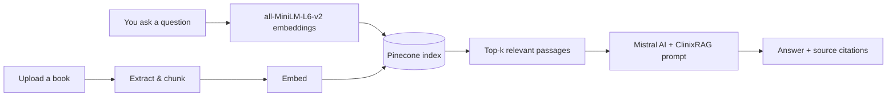

# ClinixRAG

**ClinixRAG** is a retrieval-augmented medical assistant. It answers clinical questions from a trusted medical library — and from any reference book you upload — using LangChain, Pinecone, Hugging Face embeddings and Mistral AI.

> ⚠️ **Medical disclaimer:** ClinixRAG is for education and research. It is not a doctor, does not diagnose, and must not replace professional medical advice, diagnosis or treatment. In an emergency, contact your local emergency number.

---

## ✨ What's new

- **New identity** — Medical Bot is now **ClinixRAG**.
- **Upload your own books** — PDF, DOCX, TXT, Markdown, EPUB and RTF files are chunked, embedded and added to the same Pinecone index, so the assistant answers from them immediately.
- **Source citations** — every answer shows the book (and page, when available) it was grounded in.
- **Complete UI rebuild** — a calm, clinical glass interface with a knowledge library, drag-and-drop uploads, dark/light themes, markdown answers, typing states, toasts and a responsive mobile layout.
- **Production-shaped backend** — the notebook entry point is now a proper Flask app (`app.py`) with the same RAG pipeline, plus a scriptable `store_index.py`.
- **Graceful setup** — the UI loads even before API keys are configured and tells you exactly what is missing.

---

## 🧠 How it works



1. Your question is embedded with `sentence-transformers/all-MiniLM-L6-v2`.
2. Pinecone returns the most relevant passages from the indexed library.
3. LangChain stuffs that context into the ClinixRAG prompt.
4. Mistral answers from the retrieved evidence and the UI lists the sources.

Uploaded books go through the same pipeline: extract → chunk → embed → upsert into Pinecone.

---

## 🗂️ Project structure

```
ClinixRAG/
├── app.py                  # Flask app + chat/upload/library APIs
├── store_index.py          # Index ./Data PDFs into Pinecone
├── src/
│   ├── helper.py           # PDF/DOCX/EPUB extraction, chunking, embeddings
│   ├── prompt.py           # Grounded, safety-first system prompt
│   └── rag.py              # Lazy RAG service + upload manifest
├── templates/
│   └── chatbot.html        # ClinixRAG interface
├── static/
│   ├── css/style.css       # Design system, light/dark themes
│   ├── js/app.js           # Chat, uploads, library, markdown, toasts
│   └── img/favicon.svg
├── Data/                   # Seed medical PDFs (e.g. Gale Encyclopedia)
├── requirements.txt
├── .env.example
└── README.md
```

---

## 🚀 Run it locally

### 1. Clone and enter the project

```bash
git clone https://github.com/Aum-17/Medical_Chatbot.git
cd Medical_Chatbot
```

> The repository URL still uses the original name; the project itself is ClinixRAG.

### 2. Create a virtual environment

Python **3.10–3.12** is recommended.

```bash
python3.12 -m venv .venv
source .venv/bin/activate        # macOS / Linux
# .venv\Scripts\activate         # Windows
```

### 3. Install dependencies

```bash
pip install --upgrade pip
pip install -r requirements.txt
```

### 4. Add your API keys

```bash
cp .env.example .env
```

Open `.env` and fill in:

```dotenv
PINECONE_API_KEY="your_pinecone_api_key"
MISTRAL_API_KEY="your_mistral_api_key"
```

Get keys from [Pinecone](https://app.pinecone.io) and [Mistral AI](https://console.mistral.ai). Keep the default `PINECONE_INDEX_NAME="medicalbot"` if you already have an index with that name; otherwise change both the env value and re-index.

### 5. Build the knowledge base (first run only)

This reads every PDF in `Data/`, creates the Pinecone index if needed, and uploads embeddings:

```bash
python store_index.py
```

Useful flags:

```bash
python store_index.py --data ./my_books     # index a different folder
python store_index.py --reset --yes         # recreate the index from scratch
```

> The first run downloads the ~90 MB embedding model. A free Pinecone serverless index is enough.

### 6. Start ClinixRAG

```bash
python app.py
```

Open **http://127.0.0.1:5000**.

That's it. Ask a question, or drag a book onto the upload area in the left sidebar.

---

## 📚 Uploading books

Use the **Knowledge library** panel in the sidebar:

1. Drag a file onto the drop zone, or click **Browse**.
2. Supported: **PDF · DOCX · TXT · MD · EPUB · RTF**, up to **40 MB** each (configurable).
3. The file is extracted, chunked, embedded and upserted into Pinecone.
4. The book appears in the library and the assistant can answer from it immediately.

Large books take longer to index — the upload card shows progress. Deleting a book removes it from the library and attempts to remove its vectors from Pinecone.

Uploaded files are **not stored on disk**; only their embeddings and a small metadata manifest (`instance/documents.json`) are kept.

---

## ⚙️ Configuration

| Variable | Default | Purpose |
| --- | --- | --- |
| `PINECONE_API_KEY` | — | **Required.** Pinecone API key. |
| `MISTRAL_API_KEY` | — | **Required.** Mistral API key (`MISTRALAI_API_KEY` also accepted). |
| `PINECONE_INDEX_NAME` | `medicalbot` | Vector index name. |
| `MISTRAL_MODEL` | `mistral-medium` | Mistral chat model. |
| `MAX_UPLOAD_MB` | `40` | Maximum size per uploaded book. |
| `PORT` | `5000` | Flask port. |
| `FLASK_DEBUG` | `0` | Set to `1` for the dev reloader. |
| `LOG_LEVEL` | `INFO` | Python log level. |

---

## 🔌 API

| Method | Route | Description |
| --- | --- | --- |
| `GET` | `/` | ClinixRAG interface |
| `POST` | `/api/chat` | `{ "message": "..." }` → `{ "answer": "...", "sources": [...] }` |
| `POST` | `/get` | Backwards-compatible alias for `/api/chat` (form or JSON) |
| `POST` | `/upload` | Multipart `files` → indexes one or more books |
| `GET` | `/api/documents` | Library manifest |
| `DELETE` | `/api/documents/<id>` | Remove a book and its vectors |
| `GET` | `/api/status` | Configuration and library status |
| `GET` | `/healthz` | Health check |

---

## 🧪 Quick checks

```bash
# health
curl http://127.0.0.1:5000/healthz

# ask a question
curl -X POST http://127.0.0.1:5000/api/chat \
  -H "Content-Type: application/json" \
  -d '{"message":"What are the symptoms of asthma?"}'

# upload a book
curl -X POST http://127.0.0.1:5000/upload \
  -F "files=@./Data/Gale Encyclopedia of Medicine. Vol. 2. 2nd ed.pdf"
```

---

## 🛠️ Troubleshooting

| Problem | Fix |
| --- | --- |
| “Setup needed” badge | Add both keys to `.env` and restart `python app.py`. |
| “Could not open the Pinecone index” | Run `python store_index.py`, or check `PINECONE_INDEX_NAME`. |
| Embedding model download is slow | First run only; later runs use the Hugging Face cache. |
| Upload says “Unsupported format” | Use PDF, DOCX, TXT, MD, EPUB or RTF. |
| Answers ignore a deleted book | Pinecone cleanup can be eventually consistent; re-run `python store_index.py --reset --yes` to rebuild. |
| `torch` install issues | Use Python 3.10–3.12 and a fresh virtual environment. |

---

## ☁️ Deploy

```bash
gunicorn -w 2 -b 0.0.0.0:8000 app:app
```

Set the same environment variables on your host. On serverless platforms, `instance/documents.json` is ephemeral — the Pinecone index remains the source of truth.

---

## 🧰 Tech stack

Python · Flask · LangChain · Pinecone · Mistral AI · Hugging Face · sentence-transformers · HTML/CSS/JavaScript

---

## 📄 License

See [LICENSE](LICENSE).
